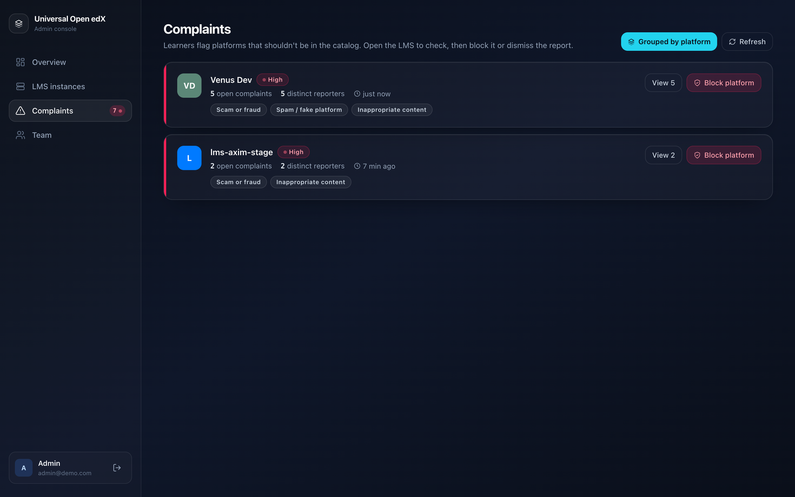

# How it works

Three groups of people touch the system, and the registry ties them together.

!!! note "This page describes the open catalog"
    Everything below — self-service registration, learner reports, moderation —
    belongs to the shared public catalog. Run the same registry for a single
    organization or as a provider portal and the moderation half disappears
    entirely, because nobody is listing platforms you didn't choose. See
    [Three ways to run it](modes.md).

```
  LMS owner                Registry (web)                    Learner (mobile app)
 ┌──────────┐   register   ┌───────────────────┐   catalog   ┌──────────────────┐
 │  Wizard  │─────────────▶│  auto-approved     │◀───────────│  search / browse │
 └──────────┘              │  + admin review    │            │  pick an LMS     │
       ▲                   │                    │            │                  │
       │ email + appeal    │  complaints inbox  │◀── report ─│  "report this    │
       └───────────────────│  block / dismiss   │            │   LMS" (Profile) │
                           └───────────────────┘            └──────────────────┘
```

## The pieces

| Piece | Who uses it | What it does |
|-------|-------------|--------------|
| **Mobile app** (iOS + Android) | Learners | Find a platform, sign in, learn, report problems |
| **Registration wizard** (web) | LMS owners | Register and theme an Open edX instance |
| **Admin console** (web) | Administrators | Review platforms, triage complaints, block/restore |
| **Registry API** | The apps | Serves the catalog and takes in complaints |

## The lifecycle of a platform

1. **Registered.** An owner completes the wizard. The registry verifies the URL
   and OAuth client are reachable, then adds the instance to the catalog.
2. **Live, unverified.** With auto-approve on (the pilot default), the platform is
   searchable in the app immediately. It's flagged *unreviewed* so an admin knows
   to confirm it.
3. **Reviewed.** An admin checks it and marks it reviewed.
4. **Reported.** If learners flag it, complaints collect against it.
5. **Blocked (if needed).** An admin removes it from the catalog. The app stops
   showing it. The owner is told why.
6. **Restored.** The owner fixes the issue and requests a re-review; an admin
   restores it.

## Trust & safety, in one line

Anyone can register a platform, so anyone can register a **bad** one. The whole
moderation side exists for that: learners report, admins see volume and distinct
reporters, and **a human always makes the block decision** — there is no automatic
takedown that a spam campaign could trigger.

<figure markdown>
  
  <figcaption>Grouping by platform shows distinct reporters — how you tell a real problem from one person filing many reports</figcaption>
</figure>
