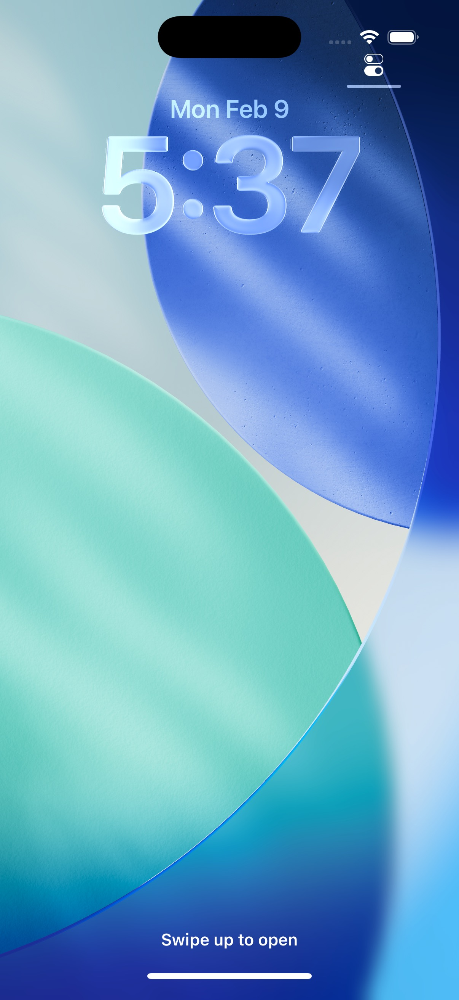

# For learners — the mobile app

The app is a normal Open edX mobile app, with one difference at the start: instead
of being tied to a single platform, you pick which Open edX platform you want to
use.

<figure markdown>
  { width="280" }
  <figcaption>The Universal Open edX app</figcaption>
</figure>

## 1. Find your platform

When you first open the app you land on **Find your LMS**.

- **Search mode** (the default): type your platform's name or web address. Matching
  platforms from the catalog appear; tap one to select it.
- **Scan a QR code**: if your platform shows a QR code, scan it to jump straight
  to it.
- **Curated mode**: if you installed a provider's own branded build, you skip the
  search and see that provider's platforms in a list — just tap the one you want.

Once you pick a platform, the app themes itself to match it (logo, colors) and
takes you to sign in.

<figure markdown>
  { width="820" }
  <figcaption>Browsing courses after selecting a platform</figcaption>
</figure>

## 2. Sign in and learn

Sign in with the account you already use on that platform. From there it's the
standard Open edX experience: your dashboard, course content, videos, dates, and
offline downloads.

<figure markdown>
  { width="820" }
  <figcaption>Course content</figcaption>
</figure>

## 3. Report a problem with a platform

Because anyone can add a platform to the catalog, you might run into one that
doesn't belong there. From the platform list, choose **Report a problem** and pick
what's wrong:

| Reason | Use it when… |
|--------|--------------|
| Inappropriate or adult content | The platform hosts adult or harmful content |
| Scam or phishing | It asks for payment/credentials in a suspicious way |
| Impersonation | It pretends to be a real institution it isn't |
| Spam or fake platform | It isn't a real learning platform |
| Doesn't work / can't sign in | It's broken or inaccessible |
| Something else | Anything not covered above |

You can **attach a screenshot** so an administrator sees exactly what you saw. The
app shrinks and compresses the image before sending, so it uploads quickly even on
mobile data. Adding your email is optional.

!!! info "What happens next"
    Your report goes straight to the administrators. They open the platform to
    check it and decide whether to remove it from the app. You won't see the
    platform disappear yourself, but a real person reviews every report.

## Getting the app

- **iOS** — TestFlight (pilot)
- **Android** — APK / Play (pilot)

Download links are on the [project landing page](https://openedx-lms.stepanok.com).
