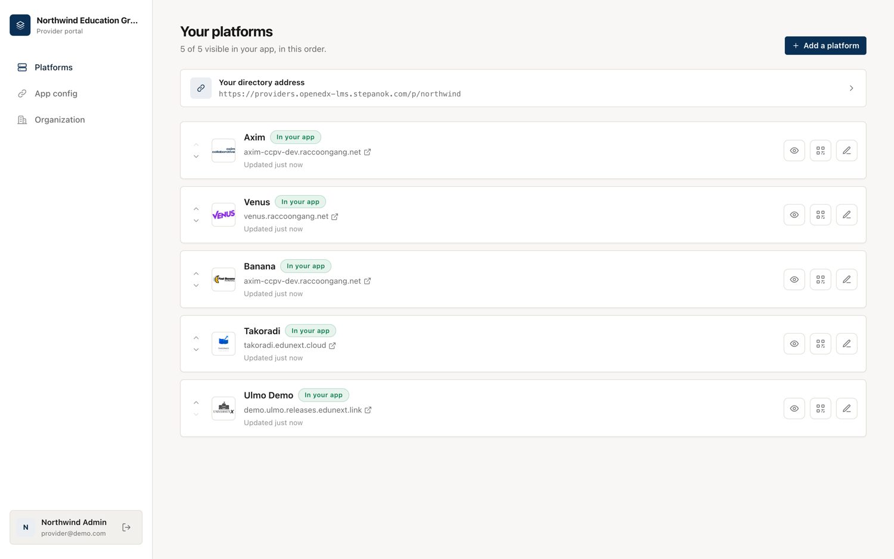
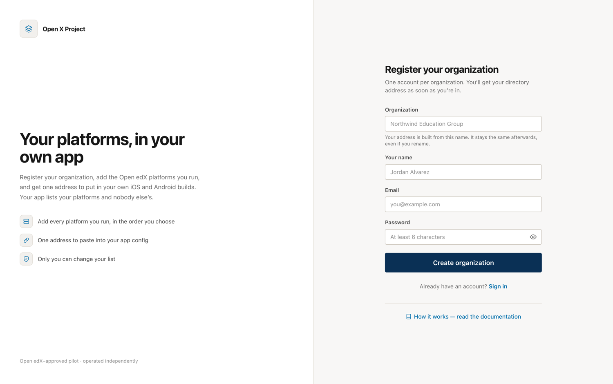
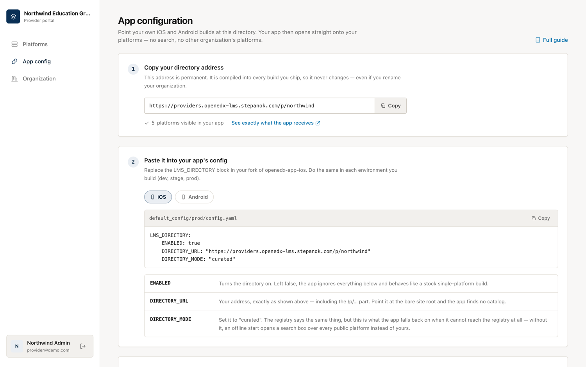
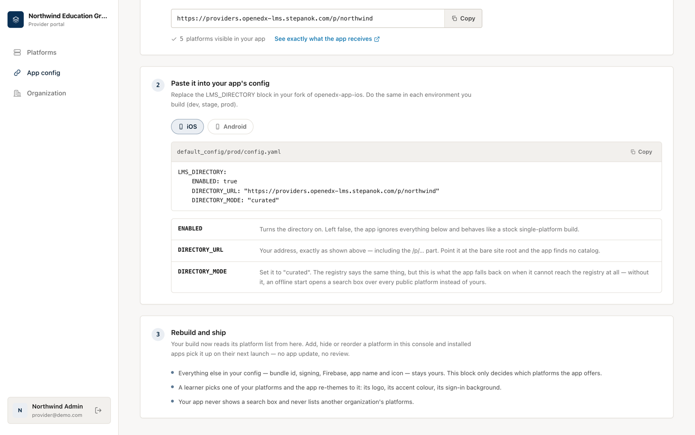
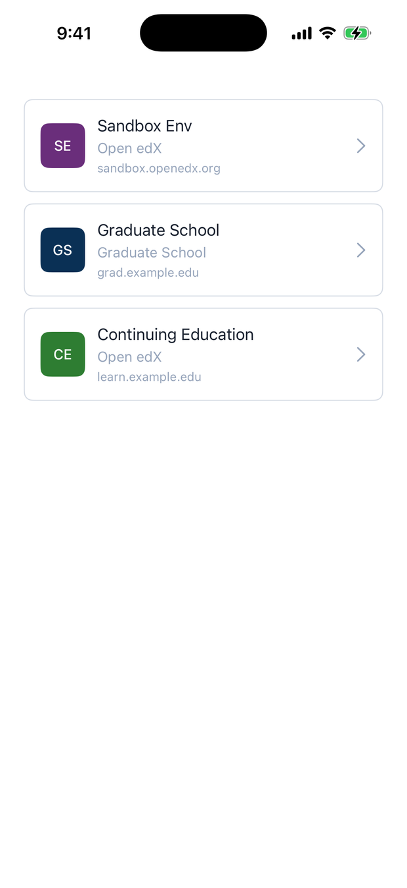
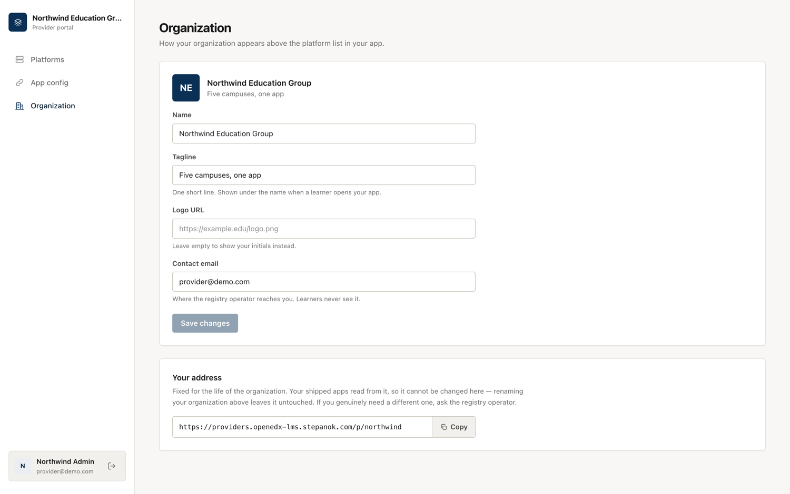
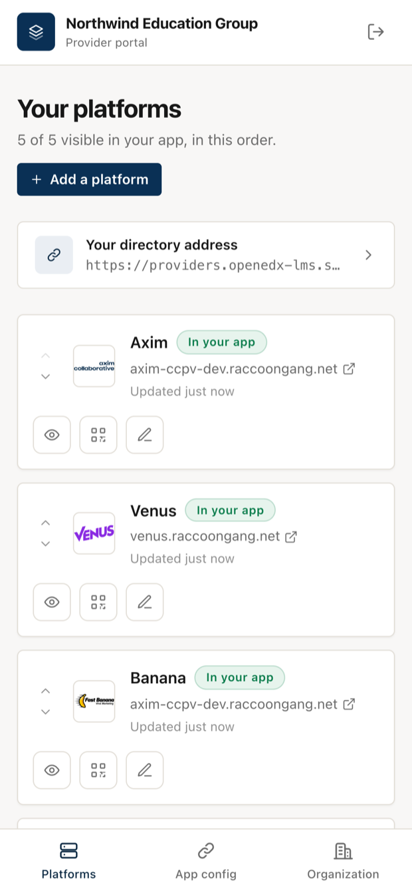
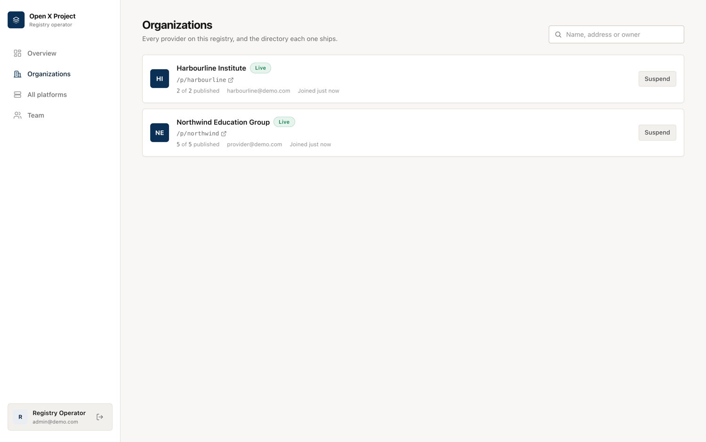

# Provider portal

You run five Open edX platforms. You want **one app, under your own name**, that
opens onto those five and nothing else — not a public catalog, not somebody
else's platforms. You don't want to run a server to get it.

That's the provider portal. One registry, many provider organizations. You sign
up, add your platforms, and the portal hands you a permanent address:

```
https://providers.example.com/p/your-org
```

You paste that address into your own iOS and Android builds, ship them under your
own name, and your learners see your five platforms the moment they open the app.

<figure markdown>
  
  <figcaption>Your platforms, in the order your app will show them</figcaption>
</figure>

!!! info "Which mode is this?"
    This is the third of three ways to run the registry — see
    [Three ways to run it](modes.md). If you want to host the registry yourself
    and it only ever serves your own organization, you want
    [curated mode](provider-mode.md) instead: same result in the app, but the
    server is yours.

## What you get

**Your own list.** Only you can add, hide or reorder platforms in your directory.
No other provider on the portal can touch it, and you can't see theirs.

**Your own app.** The bundle id, the name, the icon, the signing certificate and
the Firebase project stay yours. The portal only decides which platforms the app
offers.

**Per-platform branding.** Each platform keeps its own logo, accent colour and
sign-in background. A learner picks one and the app re-themes to it.

**Changes without a release.** Add a platform, hide one, or change the order in
the console and installed apps pick it up on their next launch. No App Store
review, no Play rollout.

**No search box, no reporting.** Your learners were handed these platforms by
you, so the app doesn't offer to search the wider world and doesn't offer to
report them. Both entry points are hidden in the app, and the endpoints behind
them are closed on the server.

## Set it up

### 1. Register your organization

Sign up on the portal. The name you give becomes your permanent address — "Northwind
Education Group" gives you `/p/northwind-education-group`.

<figure markdown>
  
  <figcaption>One account per organization; signing up creates the organization with it</figcaption>
</figure>

!!! warning "The address is permanent"
    It gets compiled into every build you ship, so renaming it later would take
    every installed app offline with no way for you to undo it. Renaming your
    *organization* is fine and changes nothing about the address. If you truly
    need a different one, ask the registry operator before you ship anything.

### 2. Add your platforms

**Platforms → Add a platform** opens the same wizard LMS owners use: the
instance URL, its OAuth client id, branding, and the mobile feature flags. Each
platform you add is live in your directory as soon as you save it.

Use the eye button to hide one while you're still setting it up, and the arrows to
set the order the app lists them in.

You'll need, per platform:

| What | Where it comes from |
|------|--------------------|
| Instance URL | Your Open edX site, e.g. `https://learn.example.edu` |
| OAuth client id | Django admin → **Django OAuth Toolkit → Applications** on that instance |
| Logo and accent colour | Yours — this is what a learner sees in the picker |

Open edX **Ulmo or newer** is required. Older releases are missing mobile API
endpoints the app depends on.

### 3. Wire it into your apps

**App config** gives you the address and the exact block to paste.

<figure markdown>
  
  <figcaption>Copy the address, paste the block, rebuild</figcaption>
</figure>

In your fork of `openedx-app-ios` or `openedx-app-android`, edit
`default_config/<env>/config.yaml` — for every environment you actually build:

```yaml
LMS_DIRECTORY:
  ENABLED: true
  DIRECTORY_URL: "https://providers.example.com/p/your-org"
  DIRECTORY_MODE: "curated"
```

| Key | What it does |
|-----|--------------|
| `ENABLED` | Turns the directory on. Left `false`, the app ignores the rest and behaves like a stock single-platform build. |
| `DIRECTORY_URL` | Your address, **including the `/p/…` part**. Point it at the bare site root and the app finds no catalog. |
| `DIRECTORY_MODE` | Set it to `"curated"`. See the warning below — this one is load-bearing. |

!!! danger "Always set `DIRECTORY_MODE: \"curated\"`"
    The registry already tells the app it is curated, so this looks redundant. It
    isn't. Both apps fall back to **search** mode when they can't reach the
    registry at all, and Android does so silently. Without the local flag, a
    learner opening your branded app on a bad connection gets a search box over
    every public Open edX platform instead of your five. With it, the app stays
    yours no matter what the network does.

<figure markdown>
  
  <figcaption>The block is per-platform because the two repositories indent their config differently — copy the one you're building</figcaption>
</figure>

### 4. Check it before you ship

Open `https://providers.example.com/p/your-org/api/v1/directory` in a browser —
the **See exactly what the app receives** link in the console does the same. You
should see your platforms, in your order, and nothing else:

```json
{
  "items": [
    { "id": "1", "title": "Axim",  "base_url": "https://axim-ccpv-dev.raccoongang.net", ... },
    { "id": "2", "title": "Venus", "base_url": "https://venus.raccoongang.net", ... }
  ]
}
```

If you get `404 Unknown directory`, the address is wrong or your organization is
suspended. If you get *"This is a provider portal…"*, you dropped the `/p/…` part.

## What a learner sees

The app opens straight onto your platform list — no search, no intro screen. A
learner taps one and the app re-themes to it and signs them in against it.

<figure markdown>
  { width="300" }
  <figcaption>The platform picker in a curated build. A provider-portal build shows this same screen, filled from your <code>/p/…</code> directory — the app cannot tell the two apart, which is why it needs no code change.</figcaption>
</figure>

## Your organization's details

**Organization** sets the name, tagline and logo the app shows above the platform
list, and the contact address the registry operator uses to reach you.

<figure markdown>
  
  <figcaption>Renaming the organization never changes the address underneath it</figcaption>
</figure>

The console works on a phone, so you can hide a platform or check your address
without a laptop.

<figure markdown>
  { width="300" }
  <figcaption>The sidebar becomes a bottom tab bar under 1024px</figcaption>
</figure>

## What the registry operator can and can't do

Someone runs the portal, and it is worth being precise about what that means.

**They can** see the list of organizations, how many platforms each has published,
and the owner's email; and they can **suspend** an organization, which makes its
`/p/<slug>` return nothing until it is restored. Suspension deletes nothing — the
platforms are kept and the same address comes back on restore.

**They can't** edit your platforms for you, and there is no route that lets one
provider read or change another's — the console has no such button and the API
answers `404` rather than telling you the other organization exists.

<figure markdown>
  
  <figcaption>The operator's view: every tenant, the directory each one ships, and one reversible action</figcaption>
</figure>

## Running a portal yourself

Set `DIRECTORY_MODE=portal` and give the deployment a public URL so the addresses
it hands out are the real ones:

```bash
DIRECTORY_MODE=portal
REGISTRY_PUBLIC_URL=https://providers.example.com
SECRET_KEY=<a long random string>
ADMIN_EMAIL=you@example.com
ADMIN_PASSWORD=<set before first boot>
```

`REGISTRY_PUBLIC_URL` matters more here than in the other modes: behind a reverse
proxy the request the app sees is plain HTTP on an internal hostname, and the
address a provider is handed ends up inside a shipped binary. Set it, or providers
compile the wrong URL into their apps.

Portal mode expects a **fresh database**. Rows created before the switch belong to
no organization and are therefore invisible to every `/p/<slug>` directory — safe,
but not what you want. Run a portal as its own deployment rather than converting a
running catalog. See [Configuration & deployment](deploying.md).

## Troubleshooting

**The app shows a search box.** `DIRECTORY_MODE` isn't set to `"curated"` in the
config you actually built, or the app couldn't reach the registry on launch. Set
the local flag; it can only ever add curated mode, never remove it.

**The app shows nothing.** Nothing is published. Check the platform count in
**App config**; a platform that is hidden, or still pending, isn't served.

**`404 Unknown directory`.** The slug is wrong, or the organization is suspended.
An unknown slug and a suspended one answer identically on purpose, so that
nobody can enumerate the providers on a portal — check with the operator.

**A trailing space in `DIRECTORY_URL`.** iOS keeps it, encodes it as `%20`, and
every request 404s. Copy the address from the console rather than retyping it.
